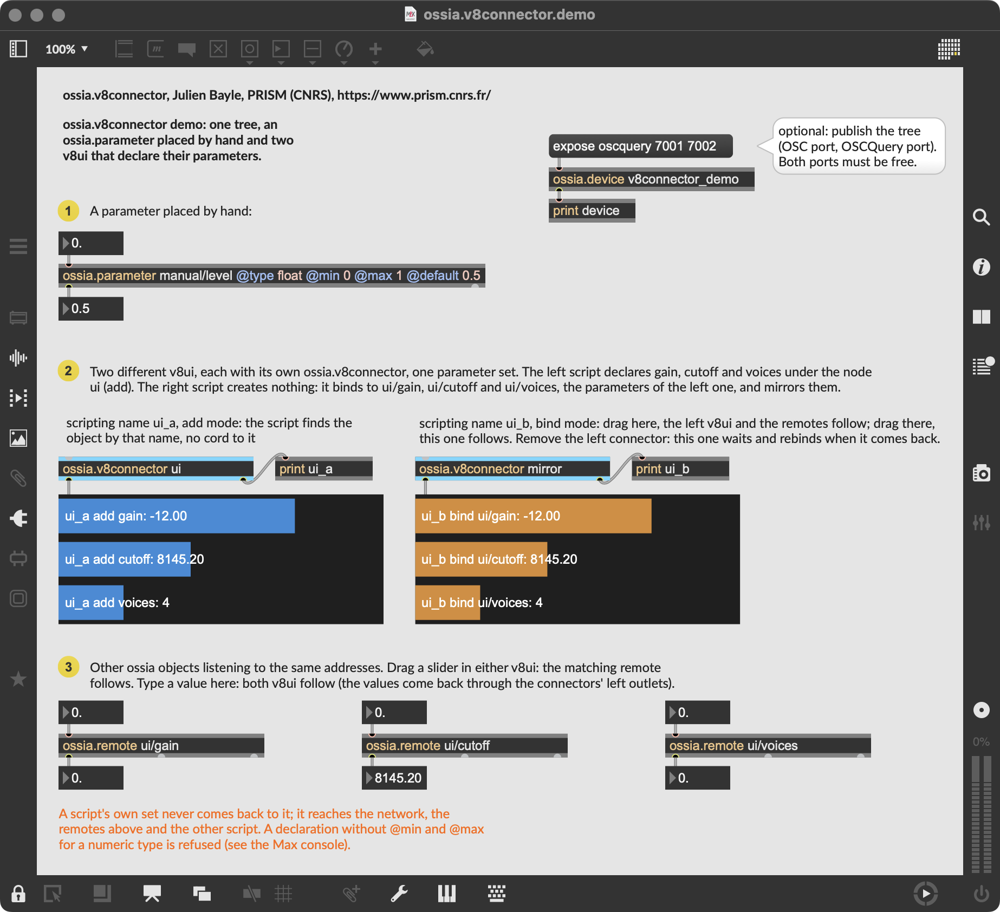

ossia-prism (PRISM, CNRS)
===

**ossia-prism** is the Max package built from this repository: [ossia](https://ossia.io) 2.1.0 for Max (every `ossia.*` object of the official package, unchanged except for the fixes listed under [Differences from ossia 2.1.0](#differences-from-ossia-210)) plus one object, **`ossia.v8connector`**. It replaces the official `ossia` package: both contain the same objects and cannot be installed together. Binaries (macOS universal, Apple Silicon and Intel; Windows x64) are published on the project's [Releases](https://gitlab.prism.cnrs.fr/labo/outils/libossia/-/releases) page; the French installation notes are in [docs/prism/LISEZMOI.txt](docs/prism/LISEZMOI.txt).

Julien Bayle, PRISM (CNRS), https://www.prism.cnrs.fr/

### ossia.v8connector

`[ossia.v8connector <name>]` is a node of the ossia tree whose parameters are declared by messages, typically from a `v8` or `v8ui` script, so that a script can publish its own parameters without one `ossia.parameter` object per parameter. It registers like an `ossia.model`: under the nearest `ossia.model`, `ossia.device` or `ossia.client` of the patcher hierarchy, or under the global device. Its parameters live in the same tree as the ones declared by hand, and are served by the same OSCQuery server.

| Message | Effect |
|---|---|
| `add <address> @type ... @min ... @max ...` | creates a parameter under the node, with the attribute names of `ossia.parameter` (`@type`, `@min`, `@max`, `@range`, `@unit`, `@default`, `@clip`, `@mode`, `@description`, `@tags`, `@priority`, `@rate`, `@critical`, `@invisible`, `@mute`, `@repetitions`, `@enable`, `@recall_safe`). A numeric type requires `@min` and `@max`, or `@range`. A `@type` that the `@unit` would change is refused (`color.rgb` is `vec3f`, `color.rgba` is `vec4f`). `@clip none` is accepted as the free mode. |
| `remove <address>`, `clear` | removes one parameter, or every parameter of this instance |
| `bind <address>`, `unbind <address>` | follows a parameter that exists elsewhere (an `ossia.parameter`, another instance), addressed as an `ossia.remote` would; creates nothing, follows the parameter when it disappears and comes back |
| `set <address> <values...>` | pushes a value to a declared or bound parameter |
| left outlet | `<address> <values...>` for every value changed by another source, bounded and filtered like the outlet of every ossia object; `ready` once the object has registered; `refused <address> <reason>` for every refusal of `add`, `bind`, `set`, `remove` or `unbind` |
| right outlet | `address`, `add`, `remove`, `clear`, `bind <address> <count>` and `error` messages |

Minimal `v8` or `v8ui` script, with the helper `javascript/ossia.v8connector.js`. The object has the scripting name `synth`; its left outlet is patched into the script's inlet, nothing else is wired:

```js
const OssiaConnector = require("ossia.v8connector");
const synth = new OssiaConnector("synth");

function loadbang() {
  synth.declare({
    gain:   { type: "float", min: -60, max: 6, unit: "gain.db", default: -12 },
    cutoff: { type: "float", range: [20, 20000], unit: "time.hz" },
    voices: { type: "int", min: 1, max: 16, default: 4 },
  });
  synth.on("gain", (v) => { post("gain", v, "\n"); });
}

function anything() { synth.dispatch(messagename, arrayfromargs(arguments)); }

function bang() { synth.set("gain", -6); }
```

`synth.bind("other/gain")` follows a parameter declared elsewhere instead of creating one. The helper keeps the declarations and replays them when the object sends `ready`, so the object can be deleted and recreated. It reports every `refused` message in the Max console and calls `synth.onRefused(address, reason)` when it is set.

#### Recipes

**Add and remove from a script.** The helper sends `add` and `remove` itself: it reaches the object through its scripting name (the varname set in the inspector), so declaring needs no patch cord. The left outlet is patched into the script only to receive values, `ready` and `refused`. A `v8ui` grid where a click creates `cell/x/y` and a second click removes it:

```js
const OssiaConnector = require("ossia.v8connector");
const grid = new OssiaConnector("grid");   // [ossia.v8connector grid], varname "grid"
const cells = new Set();

function toggle(x, y) {
  const address = "cell/" + x + "/" + y;
  if (cells.has(address)) {
    cells.delete(address);
    grid.remove(address);   // sends: remove cell/3/4
  } else {
    cells.add(address);
    grid.add(address, { type: "float", min: 0, max: 1, default: 0 });
    // sends: add cell/3/4 @type float @min 0 @max 1 @default 0
  }
}

function anything() { grid.dispatch(messagename, arrayfromargs(arguments)); }
```

When the object is deleted and recreated (undo, paste), it sends `ready` and the helper replays the cells still declared, not the removed ones. `tests/Network/V8ConnectorHelperTest.js` runs this example outside Max: `node tests/Network/V8ConnectorHelperTest.js`.

**Who owns a parameter.** An instance removes only what it declared. `remove cell/3/4` sent to another instance is refused there, with `refused cell/3/4 unknown address 'cell/3/4'` on its left outlet, and the parameter stays. Each instance replays its own declarations on every `ready`, so a removal made by another instance would not last. To act on a parameter declared elsewhere, `bind` it and `set` it; to remove it, remove it from the script that declared it.

**The name argument.** `[ossia.v8connector synth]`: the argument is required. It names the node that holds the instance's parameters, like the name of an `ossia.model`: under the enclosing `ossia.model` or `ossia.device` (or the global device), `add gain` creates `synth/gain`. It keeps the parameters of each instance apart: a second instance named `synth` in the same place becomes `synth.1`. Without an argument the object prints `ossia.v8connector needs a branch name as first argument` in the Max console. `bind` does not go through this node: its address is relative to the enclosing model or device, as for `ossia.remote`, so any instance follows the gain above with `bind synth/gain`.

### Demo and help

The demo patcher `examples/ossia.v8connector.demo.maxpat` mixes, in one tree, an `ossia.parameter` placed by hand, a `v8ui` that declares its parameters through the object and a second `v8ui` that binds to them, with `ossia.remote` objects listening to the same addresses.



The help patcher (right click on the object, Open Help) has three tabs: Basic, Script and Limits.


### Differences from ossia 2.1.0

State on 2026-10-29. "Fixed" means fixed in ossia-prism, not in ossia.

Changed in ossia-prism:

- **One `EXTENDED_TYPE` per parameter** (OSCQuery server, `src/ossia/network/oscquery/detail/json_writer_detail.cpp`, every object that publishes a parameter). libossia 2.1.0 describes a color by the `EXTENDED_TYPE` array of its components (`color.rgb.r`, `color.rgb.g`, ...), then writes the node's own extended type (`vecf`) as a second `EXTENDED_TYPE` key in the same object; a client that keeps the last duplicate key sees `vecf` and loses the color. In ossia-prism the node's extended type is not written when the parameter has a unit. Colors are still described by that array, not by `UNIT`; a parameter without a unit keeps its own extended type.
- **`@clip none`**, the OSCQuery name of the free mode, is accepted by `ossia.v8connector` only; `ossia.parameter` still expects `free`.
- Added: the `ossia.v8connector` object, the package name `ossia-prism`, the version `2.1.0+prism.N`.

Known defects, not fixed:

- Sending `expose` on a port already in use, including a second `expose`, crashes Max (OSCQuery server of `ossia.device`). Use explicit, free ports, and `stop` before exposing again.
- Max crashed twice in `ossia.v8connector` (in `branch::queue_current_value`, called when the object registers again), in a patch whose `bind` addresses point to a remote device: once 1.4 s after that device came back under the same name, once with no action on that device for 30 minutes. An earlier, identical return of the device did not crash. The cause is not established.
- An `ossia.client` connected by name (`connect <name>`, zeroconf) gets the tree, but the tree changes sent afterwards by the server (`PATH_ADDED`, `ATTRIBUTES_CHANGED`) are not applied: a parameter added on the server does not appear. In the code, these commands are only run for a client connected by URL (`connect oscquery ws://host:port`).
- The OSCQuery client sends one OSC message per value, never a bundle, even for values pushed together: 128 bound parameters changing at each frame give 128 WebSocket messages per frame. The server can send bundles.
- The server logs `remote_endpoint: Invalid argument` at each connection, with no effect seen on the served tree.
- The access mode is not enforced by the server: a read-only parameter can be written over OSC.
- The client cannot read some OSCQuery servers that are not ossia: it asks `?HOST_INFO=1` instead of `?HOST_INFO`, and does not read `chunked` HTTP replies.
- On Windows, the automatic discovery of OSCQuery devices (mDNS) depends on the Bonjour service being installed and running; without it, connect `ossia.client` to an explicit address.

### Known limits

- `@priority` is stored on the node but does not order the outputs of `ossia.v8connector`: ossia-max orders the outputs of `ossia.parameter` and `ossia.remote` only.
- An `ossia.model` or `ossia.view` added to the patcher after the object has registered does not take it under its node: send `address <name>` to the object, or reload the patcher.
- `ready` and `refused` are reserved addresses; inside one instance an address is either declared by `add` or followed by `bind`.
- Two instances with the same name become `name` and `name.1`, like two `ossia.model`.
- The defects of ossia that ossia-prism does not fix are listed under [Differences from ossia 2.1.0](#differences-from-ossia-210).

### Building

```
cmake -S . -B build-ossia-max -GNinja -DCMAKE_BUILD_TYPE=Release -DOSSIA_MAX_ONLY=1 -DCMAKE_OSX_ARCHITECTURES="x86_64;arm64"
cmake --build build-ossia-max --target install
```

The package lands in `ossia-max-package/ossia-prism` under the build directory, or where `OSSIA_MAX_INSTALL_FOLDER` points. The headless test of the object's core is `tests/Network/V8ConnectorTest.cpp`, built with `OSSIA_TESTING`; the test of the helper is `tests/Network/V8ConnectorHelperTest.js`, run with Node.

The text below is the upstream libossia README, unchanged.

---

libossia
===

libossia is a modern C++, cross-environment distributed object model for creative coding.

It allows to declare the architecture of your creative coding application's functions as a **tree of OSC nodes and parameters**. These nodes/parameters can have attributes, which allow to declare many of their properties, such as their values, types, units, ranges, etc....

This OSC tree-based architecture (coined "device" in the OSSIA terminology) can then be exposed over the network under several protocols, some of which allow this architecture, and the properties and values of its nodes, to be fully explored and queried. For now, protocols available in the implementations are: plain OSC, OSCquery, and Minuit - more are part of libossia and will be made available in the future.

libossia offers bindings and implementations for several environments: PureData, Max/MSP, Python, C, C++, openframeworks, Unity3D, QML, Faust, SuperCollider.

You can find some documentation for the library and its various implementations is at https://ossia.io

Please feel free to ask questions on the [forum](http://forum.ossia.io/c/libossia), or to come and chat with us ! [](https://gitter.im/ossia/libossia?utm_source=badge&utm_medium=badge&utm_campaign=pr-badge)

More about the general project at: https://ossia.io

Download & Build Status
=======================
* Latest release : https://github.com/ossia/libossia/releases/latest

| Binding | Build Status | Latest Build from Master Branch |
|-|-|-|
|  | [](https://github.com/ossia/libossia/actions/workflows/ossia-max.yml) | https://nightly.link/ossia/libossia/workflows/ossia-max/master/ossia-max.zip |
|  | [](https://github.com/ossia/libossia/actions/workflows/ossia-pd.yml) | |
|  | [](https://github.com/ossia/libossia/actions/workflows/ossia-unity.yml) | |
| | [](https://github.com/ossia/libossia/actions/workflows/benchmarks.yml) | |
| | [](https://github.com/ossia/libossia/actions/workflows/doc.yml) | |
| | [](https://github.com/ossia/libossia/actions/workflows/coverage.yml) | |
| Coveralls | [](https://coveralls.io/github/ossia/libossia?branch=master) | |

Documentation
=============
* [Lib and Implementations](https://ossia.github.io/ossia-docs)
* [Examples](https://github.com/ossia/libossia/tree/master/examples)
* [Doxygen](http://ossia.github.io/libossia/html)
* [Building](https://github.com/ossia/libossia/wiki/Building)
* [Code style](https://github.com/ossia/libossia/wiki/Code-style-guide)

License
=======
Available under both LGPLv3 and CeCILL-C

[](https://app.fossa.io/projects/git%2Bhttps%3A%2F%2Fgithub.com%2FOSSIA%2Flibossia?ref=badge_shield)
