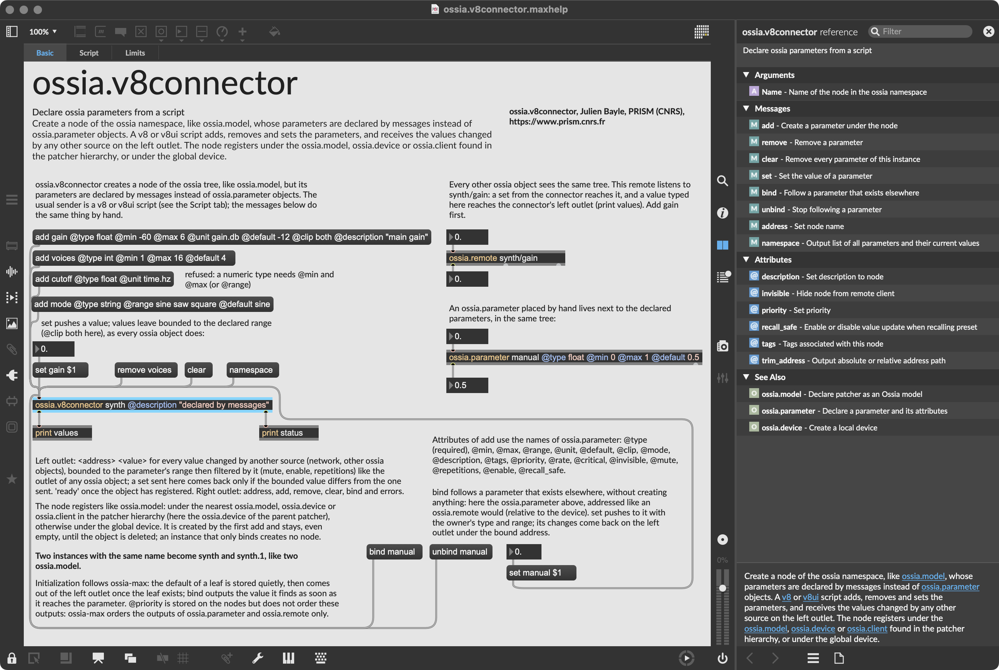
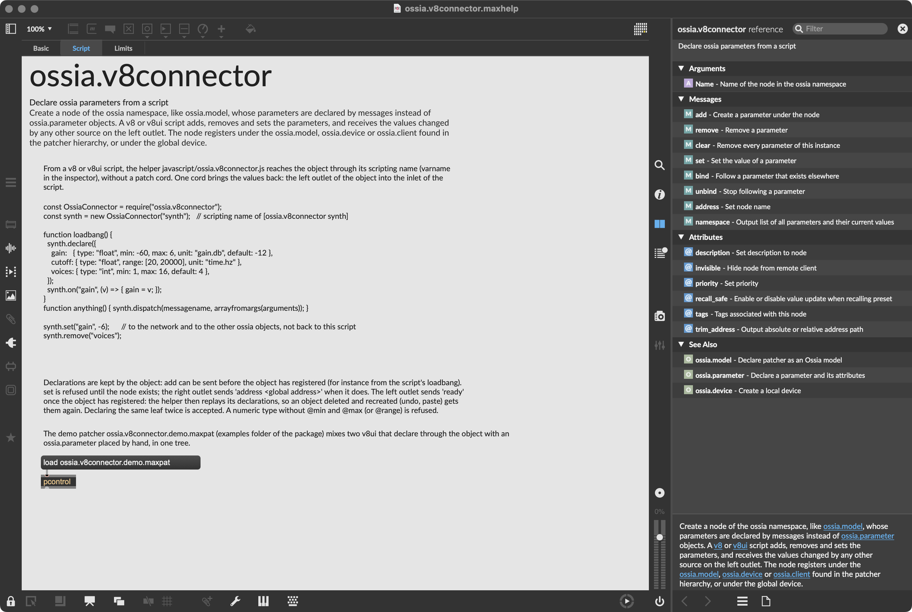
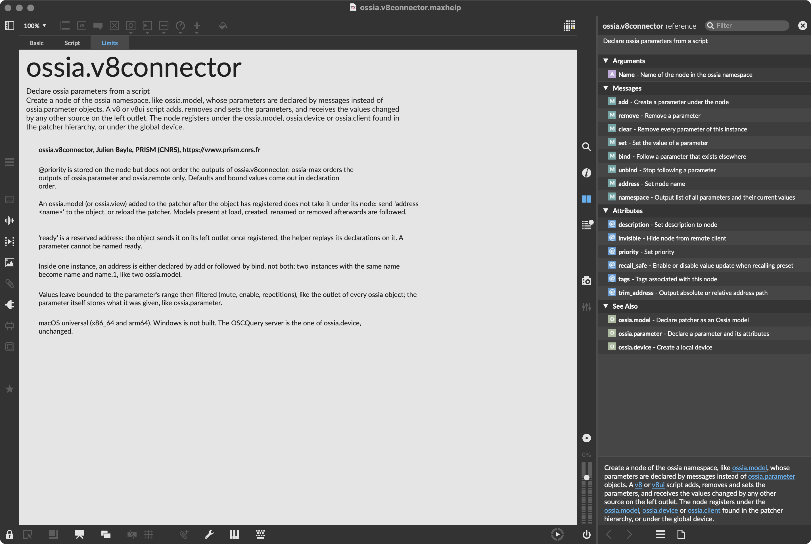

ossia-prism (PRISM, CNRS)
===

**ossia-prism** is the Max package built from this repository: [ossia](https://ossia.io) 2.1.0 for Max (every `ossia.*` object of the official package, unchanged) plus one object, **`ossia.v8connector`**. It replaces the official `ossia` package: both contain the same objects and cannot be installed together. Binaries (macOS universal, Apple Silicon and Intel; Windows x64) are published on the project's [Releases](https://gitlab.prism.cnrs.fr/labo/outils/libossia/-/releases) page; the French installation notes are in [docs/prism/LISEZMOI.txt](docs/prism/LISEZMOI.txt).

Julien Bayle, PRISM (CNRS), https://www.prism.cnrs.fr/

### ossia.v8connector

`[ossia.v8connector <name>]` is a node of the ossia tree whose parameters are declared by messages, typically from a `v8` or `v8ui` script, so that a script can publish its own parameters without one `ossia.parameter` object per parameter. It registers like an `ossia.model`: under the nearest `ossia.model`, `ossia.device` or `ossia.client` of the patcher hierarchy, or under the global device. Its parameters live in the same tree as the ones declared by hand, and are served by the same OSCQuery server.

| Message | Effect |
|---|---|
| `add <address> @type ... @min ... @max ...` | creates a parameter under the node, with the attribute names of `ossia.parameter` (`@type`, `@min`, `@max`, `@range`, `@unit`, `@default`, `@clip`, `@mode`, `@description`, `@tags`, `@priority`, `@rate`, `@critical`, `@invisible`, `@mute`, `@repetitions`, `@enable`, `@recall_safe`). A numeric type requires `@min` and `@max`, or `@range`. |
| `remove <address>`, `clear` | removes one parameter, or every parameter of this instance |
| `bind <address>`, `unbind <address>` | follows a parameter that exists elsewhere (an `ossia.parameter`, another instance), addressed as an `ossia.remote` would; creates nothing, follows the parameter when it disappears and comes back |
| `set <address> <values...>` | pushes a value to a declared or bound parameter |
| left outlet | `<address> <values...>` for every value changed by another source, bounded and filtered like the outlet of every ossia object; `ready` once the object has registered |
| right outlet | `address`, `add`, `remove`, `clear`, `bind <address> <count>` and `error` messages |

Minimal `v8` or `v8ui` script, with the helper `javascript/ossia.v8connector.js`. The object has the scripting name `synth`; its left outlet is patched into the script's inlet, nothing else is wired:

```js
const OssiaConnector = require("ossia.v8connector");
const synth = new OssiaConnector("synth");

function loadbang() {
  synth.declare({
    gain:   { type: "float", min: -60, max: 6, unit: "gain.db", default: -12 },
    cutoff: { type: "float", range: [20, 20000], unit: "time.hz" },
    voices: { type: "int", min: 1, max: 16, default: 4 },
  });
  synth.on("gain", (v) => { post("gain", v, "\n"); });
}

function anything() { synth.dispatch(messagename, arrayfromargs(arguments)); }

function bang() { synth.set("gain", -6); }
```

`synth.bind("other/gain")` follows a parameter declared elsewhere instead of creating one. The helper keeps the declarations and replays them when the object sends `ready`, so the object can be deleted and recreated.

### Demo and help

The demo patcher `examples/ossia.v8connector.demo.maxpat` mixes, in one tree, an `ossia.parameter` placed by hand, a `v8ui` that declares its parameters through the object and a second `v8ui` that binds to them, with `ossia.remote` objects listening to the same addresses.


The help patcher (right click on the object, Open Help) has three tabs: Basic, Script and Limits.







### Known limits

- `@priority` is stored on the node but does not order the outputs of `ossia.v8connector`: ossia-max orders the outputs of `ossia.parameter` and `ossia.remote` only.
- An `ossia.model` or `ossia.view` added to the patcher after the object has registered does not take it under its node: send `address <name>` to the object, or reload the patcher.
- `ready` is a reserved address; inside one instance an address is either declared by `add` or followed by `bind`.
- Two instances with the same name become `name` and `name.1`, like two `ossia.model`.
- The OSCQuery server is the one of `ossia.device`, unchanged: sending `expose` twice on a port that is already in use crashes Max. Use explicit, free ports, and `stop` before exposing again.
- On Windows, the automatic discovery of OSCQuery devices (mDNS) depends on the Bonjour service being installed and running; without it, connect `ossia.client` to an explicit address.

### Building

```
cmake -S . -B build-ossia-max -GNinja -DCMAKE_BUILD_TYPE=Release -DOSSIA_MAX_ONLY=1 -DCMAKE_OSX_ARCHITECTURES="x86_64;arm64"
cmake --build build-ossia-max --target install
```

The package lands in `ossia-max-package/ossia-prism` under the build directory, or where `OSSIA_MAX_INSTALL_FOLDER` points. The headless test of the object's core is `tests/Network/V8ConnectorTest.cpp`, built with `OSSIA_TESTING`.

The text below is the upstream libossia README, unchanged.

---

libossia
===

libossia is a modern C++, cross-environment distributed object model for creative coding.

It allows to declare the architecture of your creative coding application's functions as a **tree of OSC nodes and parameters**. These nodes/parameters can have attributes, which allow to declare many of their properties, such as their values, types, units, ranges, etc....

This OSC tree-based architecture (coined "device" in the OSSIA terminology) can then be exposed over the network under several protocols, some of which allow this architecture, and the properties and values of its nodes, to be fully explored and queried. For now, protocols available in the implementations are: plain OSC, OSCquery, and Minuit - more are part of libossia and will be made available in the future.

libossia offers bindings and implementations for several environments: PureData, Max/MSP, Python, C, C++, openframeworks, Unity3D, QML, Faust, SuperCollider.

You can find some documentation for the library and its various implementations is at https://ossia.io

Please feel free to ask questions on the [forum](http://forum.ossia.io/c/libossia), or to come and chat with us ! [](https://gitter.im/ossia/libossia?utm_source=badge&utm_medium=badge&utm_campaign=pr-badge)

More about the general project at: https://ossia.io

Download & Build Status
=======================
* Latest release : https://github.com/ossia/libossia/releases/latest

| Binding | Build Status | Latest Build from Master Branch |
|-|-|-|
|  | [](https://github.com/ossia/libossia/actions/workflows/ossia-max.yml) | https://nightly.link/ossia/libossia/workflows/ossia-max/master/ossia-max.zip |
|  | [](https://github.com/ossia/libossia/actions/workflows/ossia-pd.yml) | |
|  | [](https://github.com/ossia/libossia/actions/workflows/ossia-unity.yml) | |
| | [](https://github.com/ossia/libossia/actions/workflows/benchmarks.yml) | |
| | [](https://github.com/ossia/libossia/actions/workflows/doc.yml) | |
| | [](https://github.com/ossia/libossia/actions/workflows/coverage.yml) | |
| Coveralls | [](https://coveralls.io/github/ossia/libossia?branch=master) | |

Documentation
=============
* [Lib and Implementations](https://ossia.github.io/ossia-docs)
* [Examples](https://github.com/ossia/libossia/tree/master/examples)
* [Doxygen](http://ossia.github.io/libossia/html)
* [Building](https://github.com/ossia/libossia/wiki/Building)
* [Code style](https://github.com/ossia/libossia/wiki/Code-style-guide)

License
=======
Available under both LGPLv3 and CeCILL-C

[](https://app.fossa.io/projects/git%2Bhttps%3A%2F%2Fgithub.com%2FOSSIA%2Flibossia?ref=badge_shield)
